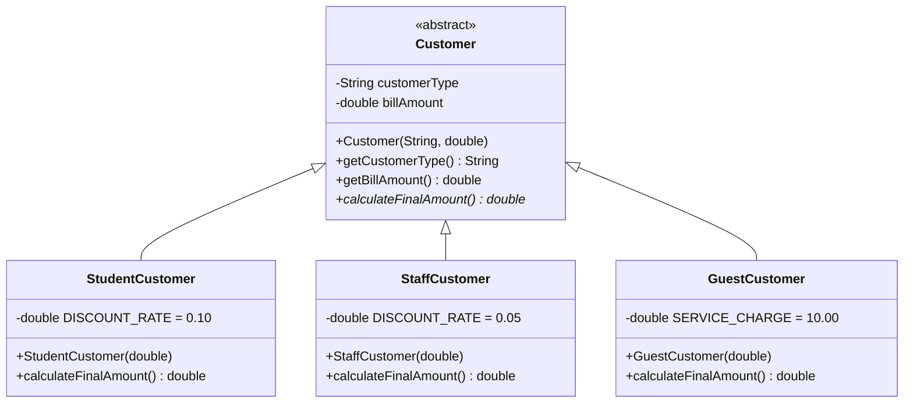
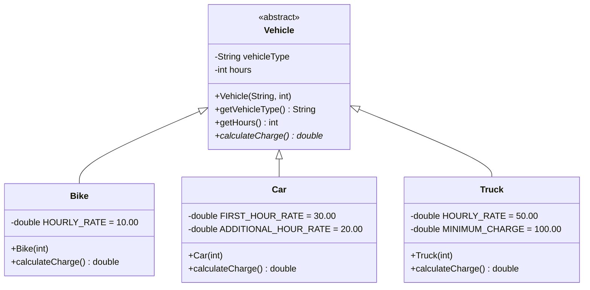
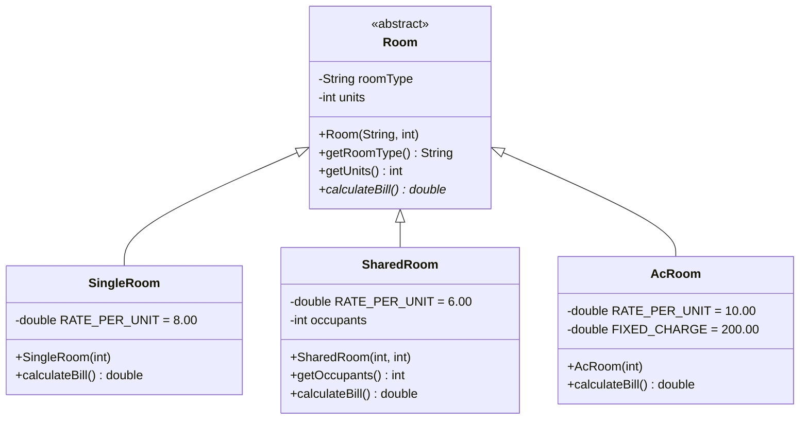
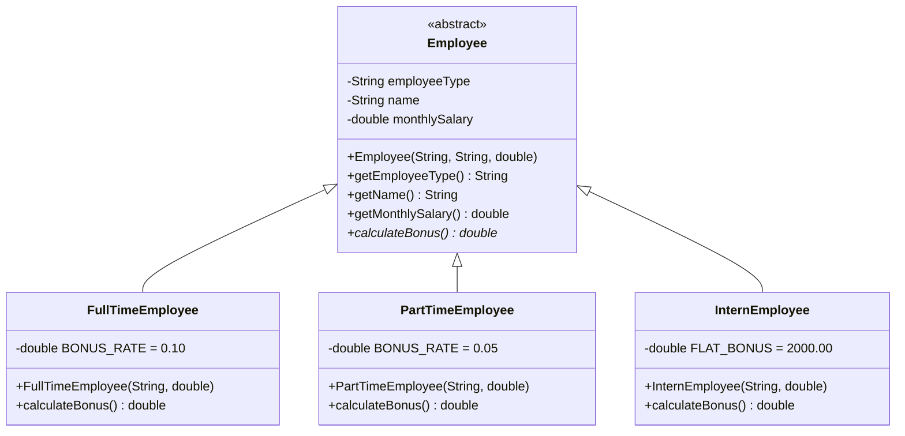
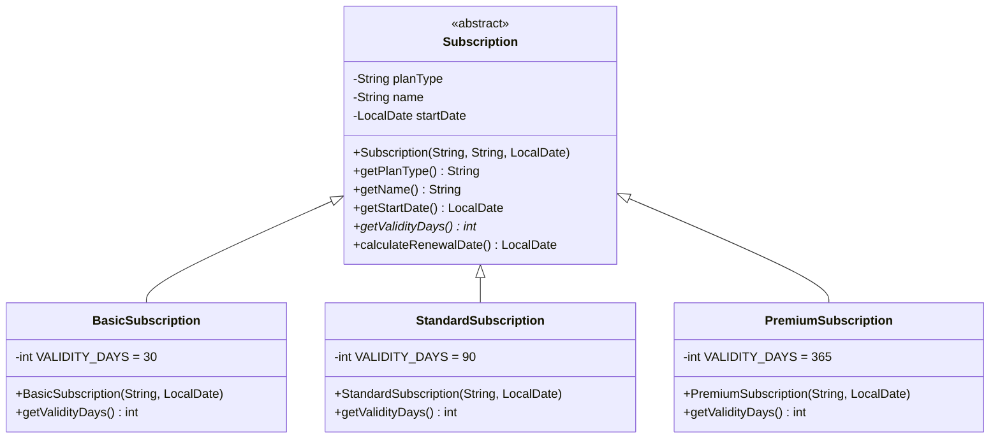

# STEP Week 8 Assignment — QLA Solutions (Quiz, Lab & Assessment)

**Institution / Platform:** STEP SEM-3 · CodInClub | Powered by BridgeLabz  
**Topic:** Object-Oriented Programming (Inheritance, Polymorphism, Method Overriding, Dynamic Method Dispatch, Open/Closed Principle, and Polymorphic Collections)

---

## Table of Contents
1. [Section 1: Coding Problems Overview & Lab Solutions](#section-1-coding-problems-overview--lab-solutions)
   - [Problem 1: The Canteen Billing Counter](#problem-1-the-canteen-billing-counter)
   - [Problem 2: The Campus Parking Charge Calculator](#problem-2-the-campus-parking-charge-calculator)
   - [Problem 3: The Hostel Electricity Bill](#problem-3-the-hostel-electricity-bill)
   - [Problem 4: The Festival Bonus Calculator](#problem-4-the-festival-bonus-calculator)
   - [Problem 5: The Streaming Plan Renewal Reminder](#problem-5-the-streaming-plan-renewal-reminder)
2. [Section 2: Week 8 Assessment Quiz Questions & Answers](#section-2-week-8-assessment-quiz-questions--answers)
3. [Section 3: Concept Questions & Architectural Explanations](#section-3-concept-questions--architectural-explanations)

---

## Section 1: Coding Problems Overview & Lab Solutions

| Problem | Primary File Name | Core Base Class / Hierarchy | Key Polymorphic Method | Description & Business Rules |
| :--- | :--- | :--- | :--- | :--- |
| **Problem 1** | [`CanteenBillingCounter.java`](./CanteenBillingCounter.java) | `Customer` -> `StudentCustomer`, `StaffCustomer`, `GuestCustomer` | `double calculateFinalAmount()` | Computes final bill amounts (Student: 10% discount, Staff: 5% discount, Guest: +₹10 service charge) without `if-else` type inspection in the counter. |
| **Problem 2** | [`CampusParkingChargeCalculator.java`](./CampusParkingChargeCalculator.java) | `Vehicle` -> `Bike`, `Car`, `Truck` | `double calculateCharge()` | Computes parking charges (Bike: ₹10/hr, Car: ₹30 1st hr + ₹20/addl hr, Truck: ₹50/hr with min ₹100) via dynamic dispatch. |
| **Problem 3** | [`HostelElectricityBillCalculator.java`](./HostelElectricityBillCalculator.java) | `Room` -> `SingleRoom`, `SharedRoom`, `AcRoom` | `double calculateBill()` | Computes room electricity costs (Single: ₹8/unit, Shared: ₹6/unit split among occupants, AC: ₹10/unit + ₹200 fee). Subtype encapsulates extra parameter `occupants`. |
| **Problem 4** | [`FestivalBonusCalculator.java`](./FestivalBonusCalculator.java) | `Employee` -> `FullTimeEmployee`, `PartTimeEmployee`, `InternEmployee` | `double calculateBonus()` | Computes festival bonus (Full-Time: 10% salary, Part-Time: 5% salary, Intern: flat ₹2,000) uniformly across employee list. |
| **Problem 5** | [`StreamingPlanRenewalReminder.java`](./StreamingPlanRenewalReminder.java) | `Subscription` -> `BasicSubscription`, `StandardSubscription`, `PremiumSubscription` | `int getValidityDays()` / `calculateRenewalDate()` | Computes renewal date using `java.time.LocalDate.plusDays()` (Basic: 30 days, Standard: 90 days, Premium: 365 days), seamlessly handling leap years. |

---

### Problem 1: The Canteen Billing Counter

#### Task & Domain Model
A college canteen serves three kinds of customers: **Students**, **Staff**, and **Guests**. Each kind of customer pays a different final amount for the same bill. For every bill, calculate the final amount to be paid, display it, and then display the total amount collected.

#### Instructions & Architectural Strategy
> *Consider how to model different customer types that share a common operation (calculating the final amount) but follow different pricing rules. Focus on how the billing counter can process a list of bills from different customer types without checking the type of each customer with if-else blocks.*

- An abstract base class `Customer` defines common attributes:
  - `customerType` (`String`)
  - `billAmount` (`double`)
  - Abstract method: `public abstract double calculateFinalAmount();`
- Subclasses implement their pricing rules:
  - `StudentCustomer`: Applies a 10% discount (`billAmount * 0.90`).
  - `StaffCustomer`: Applies a 5% discount (`billAmount * 0.95`).
  - `GuestCustomer`: Adds a flat ₹10 service charge (`billAmount + 10.00`).
- The billing counter maintains a polymorphic collection `List<Customer> bills`. In the processing loop, it simply invokes `customer.calculateFinalAmount()`. Dynamic dispatch invokes the correct subclass method at runtime with zero `if-else` or `instanceof` checks.

#### Class Diagram


#### Sample Run
- **Input:**
  ```text
  3
  STUDENT 200
  STAFF 300
  GUEST 150
  ```
- **Execution Output:**
  ```text
  STUDENT: 180.00
  STAFF: 285.00
  GUEST: 160.00
  Total: 625.00
  ```

---

### Problem 2: The Campus Parking Charge Calculator

#### Task & Domain Model
The campus parking lot allows **Bikes**, **Cars**, and **Trucks**. Each vehicle type is charged differently based on the number of hours it was parked. For every parked vehicle, calculate the parking charge, display it, and then display the total charge collected.

#### Instructions & Architectural Strategy
> *Consider how to model different vehicle types that share a common operation (calculating the parking charge) but have their own charging rules. Focus on how the parking system can calculate charges for a list of different vehicles without explicit type checking.*

- Abstract base class `Vehicle` defines:
  - `vehicleType` (`String`)
  - `hours` (`int`)
  - Abstract method: `public abstract double calculateCharge();`
- Subclasses implement vehicle-specific charging formulas:
  - `Bike`: ₹10 per hour $\rightarrow$ `hours * 10.00`.
  - `Car`: ₹30 for the first hour, plus ₹20 for each additional hour $\rightarrow$ `hours <= 1 ? 30.00 : 30.00 + (hours - 1) * 20.00`.
  - `Truck`: ₹50 per hour with a minimum charge of ₹100 $\rightarrow$ `Math.max(100.00, hours * 50.00)`.
- The parking lot processes a `List<Vehicle>` polymorphically, ensuring adherence to the Open/Closed Principle.

#### Class Diagram


#### Sample Run
- **Input:**
  ```text
  4
  BIKE 3
  CAR 4
  TRUCK 1
  CAR 1
  ```
- **Execution Output:**
  ```text
  BIKE: 30.00
  CAR: 90.00
  TRUCK: 100.00
  CAR: 30.00
  Total: 250.00
  ```

---

### Problem 3: The Hostel Electricity Bill

#### Task & Domain Model
A hostel has three kinds of rooms: **Single rooms**, **Shared rooms**, and **AC rooms**. Each room type calculates its monthly electricity bill differently. For shared rooms, the bill is split equally among the occupants, and the amount shown is what each occupant pays. For every room, calculate the bill, display it, and then display the total of all bills shown.

#### Instructions & Architectural Strategy
> *Consider how to model different room types that share a common operation (calculating the bill) but use different rules. Notice that a shared room needs one extra value (occupants); think about where that value should be stored so the main processing flow can still treat every room the same way.*

- **Critical Architectural Insight:** Subtype State Encapsulation:
  - If we put `occupants` in the base class `Room`, it would be meaningless and unused for `SingleRoom` and `AcRoom`.
  - Instead, the base class `Room` only holds properties common to all rooms (`roomType`, `units`) and exposes a zero-argument contract `public abstract double calculateBill()`.
  - `SharedRoom` encapsulates `occupants` as its own private field. Its constructor takes `(int units, int occupants)`.
  - When the main processing flow iterates over `List<Room>`, it invokes `room.calculateBill()`. It does not need to know or care whether a room is shared or has occupants.

#### Class Diagram


#### Sample Run
- **Input:**
  ```text
  3
  SINGLE 120
  SHARED 150 3
  AC 100
  ```
- **Execution Output:**
  ```text
  SINGLE: 960.00
  SHARED: 300.00
  AC: 1200.00
  Total: 2460.00
  ```

---

### Problem 4: The Festival Bonus Calculator

#### Task & Domain Model
A company pays a festival bonus to its employees. **Full-time employees**, **Part-time employees**, and **Interns** each receive the bonus in a different way. For every employee, calculate the bonus, display it with the employee's name, and then display the total bonus paid.

#### Instructions & Architectural Strategy
> *Consider how to model different employee types that share common details (name and salary) and a common operation (calculating the bonus), while each type follows its own bonus rule. Focus on how the payroll system can process a list of employees without explicit type checking.*

- Abstract base class `Employee`:
  - `name` (`String`), `monthlySalary` (`double`), `employeeType` (`String`).
  - Abstract method: `public abstract double calculateBonus();`
- Subclasses:
  - `FullTimeEmployee`: 10% of monthly salary (`monthlySalary * 0.10`).
  - `PartTimeEmployee`: 5% of monthly salary (`monthlySalary * 0.05`).
  - `InternEmployee`: Flat ₹2,000 bonus (`2000.00`), independent of salary.
- In the payroll iteration loop, `emp.calculateBonus()` evaluates polymorphically, and results are labeled by `Name: Bonus`, followed by `Total Bonus: GrandTotal`.

#### Class Diagram


#### Sample Run
- **Input:**
  ```text
  3
  FULLTIME Asha 50000
  PARTTIME Ravi 30000
  INTERN Neha 15000
  ```
- **Execution Output:**
  ```text
  Asha: 5000.00
  Ravi: 1500.00
  Neha: 2000.00
  Total Bonus: 8500.00
  ```

---

### Problem 5: The Streaming Plan Renewal Reminder

#### Task & Domain Model
A video streaming service offers three subscription plans: **Basic**, **Standard**, and **Premium**. Each plan stays valid for a different number of days from its start date. For every subscriber, calculate the date on which the plan must be renewed and display it.

#### Instructions & Architectural Strategy
> *Consider how to model different plans that share a common operation (finding the renewal date) but have different validity periods. Focus on how the system can process a list of subscribers without explicit type checking. You may use java.time.LocalDate and its plusDays() method; note that the sample includes a leap year (2024) and a change of year.*

- Abstract base class `Subscription`:
  - `planType` (`String`), `name` (`String`), `startDate` (`LocalDate`).
  - Abstract method: `public abstract int getValidityDays();`
  - Template method: `public LocalDate calculateRenewalDate() { return startDate.plusDays(getValidityDays()); }`
- Subclasses define their validity constants:
  - `BasicSubscription`: 30 days.
  - `StandardSubscription`: 90 days.
  - `PremiumSubscription`: 365 days.
- Use of modern Java date API (`java.time.LocalDate`) automatically accounts for leap years (e.g., February 2024 having 29 days) and calendar month transitions across year boundaries.

#### Class Diagram


#### Sample Run
- **Input:**
  ```text
  4
  BASIC Asha 2024-01-15
  STANDARD Ravi 2024-02-01
  PREMIUM Neha 2024-03-10
  BASIC Kiran 2024-12-20
  ```
- **Execution Output:**
  ```text
  Asha: 2024-02-14
  Ravi: 2024-05-01
  Neha: 2025-03-10
  Kiran: 2025-01-19
  ```

---

## Section 2: Week 8 Assessment Quiz Questions & Answers

### Question 1
A developer is refactoring a canteen billing counter. Initially, the code had a single `Bill` class with an `if-else if` block checking customer types (`"STUDENT"`, `"STAFF"`, `"GUEST"`) to determine discount rates. What object-oriented principle is best suited to eliminate this conditional logic while keeping the billing counter open for new customer types?
- A) Method Overloading
- B) Defensive Copying
- **C) Subtype Polymorphism (Dynamic Method Dispatch)** *(Correct Answer)*
- D) Encapsulation via Getters and Setters

**Explanation:**  
Subtype polymorphism allows the client to define an abstract method `calculateFinalAmount()` in a base `Customer` class. Subclasses (`StudentCustomer`, `StaffCustomer`, etc.) provide overridden implementations. The calling loop invokes `customer.calculateFinalAmount()` uniformly, and the runtime environment dispatches to the correct subclass method. New customer types can be added without modifying the caller.

---

### Question 2
In Problem 3 (Hostel Electricity Bill), a `SharedRoom` requires an extra attribute (`occupants`) to divide the bill, whereas `SingleRoom` and `AcRoom` do not. Where is the best place to store the `occupants` variable in an object-oriented hierarchy?
- A) In the base class `Room` as a `protected` field defaulted to 1.
- B) In a static global map keyed by room ID.
- **C) As a private field inside `SharedRoom`, passed via its constructor.** *(Correct Answer)*
- D) As a parameter to the base `Room.calculateBill(int occupants)` method.

**Explanation:**  
Placing `occupants` in the base class pollutes single and AC rooms with irrelevant state. Passing `occupants` into `calculateBill()` forces every room caller to know about occupants, breaking the uniform `calculateBill()` contract. Encapsulating `occupants` inside `SharedRoom` preserves the clean, parameterless `calculateBill()` interface on the base `Room` class.

---

### Question 3
Which of the following conditions must be met for dynamic method dispatch (runtime polymorphism) to take place in Java? (Select all that apply)
- **A) There must be an inheritance hierarchy (base class or interface).** *(Correct Answer)*
- **B) The derived class must override a method declared in the base type.** *(Correct Answer)*
- **C) The method must be invoked through a base-type reference.** *(Correct Answer)*
- D) The method in the base class must be declared `static` or `final`.

**Explanation:**  
Dynamic method dispatch requires:
1. An inheritance or interface relationship.
2. An overridden non-static, non-final method.
3. Invocation through a supertype reference pointing to a subtype instance at runtime.  
Methods declared `static`, `final`, or `private` use static binding (compile-time binding) and cannot participate in dynamic dispatch.

---

### Question 4
A vehicle parking lot charges ₹10/hr for bikes, ₹30 1st hr + ₹20/addl hr for cars, and ₹50/hr (min ₹100) for trucks. If the system needs to support a new vehicle type `Bus` (₹40/hr + ₹50 cleanup fee), which classes need modification under a well-architected polymorphic design?
- A) `CampusParkingChargeCalculator`, `Vehicle`, `Bike`, `Car`, and `Truck`
- B) Only `Vehicle` and `CampusParkingChargeCalculator`
- **C) Only a new subclass `Bus` needs to be created; the calculation loop in `CampusParkingChargeCalculator` remains unchanged.** *(Correct Answer)*
- D) All existing classes must be recompiled with new switch statements.

**Explanation:**  
This is the essence of the **Open/Closed Principle (OCP)**: software entities should be open for extension, but closed for modification. Introducing `Bus extends Vehicle` requires zero changes to the vehicle processing loop.

---

### Question 5
Consider an employee hierarchy where `FullTimeEmployee`, `PartTimeEmployee`, and `InternEmployee` extend `Employee`. If we have `List<Employee> employees`, what happens when `emp.calculateBonus()` is called during iteration?
- A) The JVM looks up the method at compile-time and executes `Employee.calculateBonus()`.
- **B) The JVM uses the virtual method table (vtable) of the actual runtime object to execute the concrete subclass implementation.** *(Correct Answer)*
- C) Java throws a `ClassCastException` unless an explicit cast `(FullTimeEmployee) emp` is performed.
- D) The compiler generates `if (emp instanceof FullTimeEmployee)` bytecode instructions behind the scenes.

**Explanation:**  
The JVM issues the `invokevirtual` bytecode instruction. At runtime, it resolves the receiver object's actual class and looks up the method offset in the class's virtual method table (vtable), directing execution to the overridden method.

---

### Question 6
Why does Problem 5 (`StreamingPlanRenewalReminder`) use `java.time.LocalDate` rather than manual day arithmetic (e.g., `day += 30`)? (Select all that apply)
- **A) `LocalDate` automatically handles month length differences (28, 29, 30, 31 days).** *(Correct Answer)*
- **B) `LocalDate` accurately accounts for leap years (such as 2024 having 29 days in February).** *(Correct Answer)*
- **C) `LocalDate` correctly handles calendar rollover across new years (e.g., December to January).** *(Correct Answer)*
- D) `LocalDate` allows performing mathematical subtraction without imports.

**Explanation:**  
Manual date arithmetic frequently breaks on edge cases such as leap years, varying month durations, and year-end rollovers. `java.time.LocalDate.plusDays()` encapsulates all Gregorian calendar rules safely.

---

### Question 7
In Java, which annotation should always be applied when implementing an inherited abstract method or replacing a superclass method, and what is its primary benefit?
- A) `@Deprecated`: signals that the superclass method is retired.
- **B) `@Override`: causes the compiler to verify that the method actually matches a superclass signature.** *(Correct Answer)*
- C) `@FunctionalInterface`: allows the class to be passed as a lambda expression.
- D) `@Inherited`: automatically copies parent fields to child classes.

**Explanation:**  
The `@Override` annotation prevents subtle compilation bugs caused by typos in method names or mismatched parameter types (which would unintentionally cause method overloading rather than method overriding).

---

### Question 8
According to the **Liskov Substitution Principle (LSP)**, which of the following is true regarding subtype behavior?
- A) A subclass may throw new checked exceptions not declared in the superclass method.
- **B) Any code expecting a base class instance must function correctly and predictably when passed any derived class instance.** *(Correct Answer)*
- C) Subclasses must always have higher visibility restrictions than their superclass methods.
- D) Subclasses cannot add new fields or methods that did not exist in the superclass.

**Explanation:**  
LSP requires behavioral compatibility: derived classes must honor the contracts, pre-conditions, post-conditions, and invariants established by the base class so that callers remain completely agnostic of the concrete subtype.

---

### Question 9
In Problem 4 (`FestivalBonusCalculator`), `InternEmployee` returns a flat ₹2,000 bonus regardless of their monthly salary. Is it acceptable for `InternEmployee` to ignore the inherited `monthlySalary` field in its `calculateBonus()` method?
- **A) Yes, because polymorphism allows derived classes to define their own specific implementation of the contract.** *(Correct Answer)*
- B) No, all subclasses must mathematically incorporate all parent class fields in their calculations.
- C) No, `InternEmployee` must throw an `UnsupportedOperationException`.
- D) No, `monthlySalary` must be set to 0.

**Explanation:**  
A contract specifies the output for a given operation (`double calculateBonus()`). How each subclass computes that result—whether via a percentage of salary or a fixed statutory amount—is entirely the responsibility of the specialized subclass.

---

### Question 10
What is the primary advantage of storing objects in a polymorphic collection (`List<Customer>`, `List<Vehicle>`, `List<Room>`) over maintaining separate collections for each concrete type (`List<Bike>`, `List<Car>`, `List<Truck>`)? (Select all that apply)
- **A) It allows uniform traversal and aggregation (e.g., single grand total calculation).** *(Correct Answer)*
- **B) It eliminates code duplication across multiple processing loops.** *(Correct Answer)*
- **C) Order of transactions or arrivals is naturally preserved in a single sequential list.** *(Correct Answer)*
- D) It bypasses JVM heap memory allocation.

**Explanation:**  
Using separate lists would require duplicating iteration logic, would make preserving the original chronological sequence of mixed inputs difficult, and would necessitate editing the processing system whenever a new type is added.

---

## Section 3: Concept Questions & Architectural Explanations

### Concept Question 1: Dynamic Method Dispatch & The Virtual Method Table (vtable)
**Prompt:** Explain the underlying mechanism that enables Java to execute the correct subclass method at runtime when invoking an overridden method through a superclass reference.

**Explanation:**  
In Java, all non-static, non-final, non-private methods are *virtual* by default. When the Java compiler compiles a method call like `customer.calculateFinalAmount()`, where `customer` has the compile-time type `Customer`, it emits the bytecode instruction `invokevirtual`.

At runtime, the JVM does not rely on the variable's declared type. Instead:
1. Each class loaded into the JVM has an associated internal structure called the **Virtual Method Table (vtable)**.
2. The vtable contains pointers/references to the executable code for all virtual methods accessible by instances of that class.
3. If a subclass overrides a parent class method, the subclass's vtable entry at that specific offset points to the subclass's overridden code block; otherwise, it points to the parent's code.
4. When `invokevirtual` executes, the JVM checks the actual object on the heap, accesses its class metadata, looks up the vtable offset, and jumps directly to the concrete implementation.

This dynamic binding happens at runtime with minimal overhead ($O(1)$ table lookup), completely removing the need for developer-written conditional branches (`if-else` or `switch`).

---

### Concept Question 2: The Open/Closed Principle (OCP) in Billing Systems
**Prompt:** Describe the Open/Closed Principle (OCP) and explain how the Canteen Billing Counter and Campus Parking Charge Calculator demonstrate this principle.

**Explanation:**  
The **Open/Closed Principle (OCP)** states:
> *"Software entities (classes, modules, functions, etc.) should be open for extension, but closed for modification."*

In both **Problem 1 (`CanteenBillingCounter`)** and **Problem 2 (`CampusParkingChargeCalculator`)**:
- The main processing routines are **closed for modification**:
  ```java
  for (Customer customer : bills) {
      double finalAmount = customer.calculateFinalAmount();
      System.out.printf(Locale.US, "%s: %.2f%n", customer.getCustomerType(), finalAmount);
      grandTotal += finalAmount;
  }
  ```
- If the university adds a new customer category (e.g., `VIPCustomer` receiving a 20% discount) or the parking lot adds `ElectricCar` (free parking):
  1. We simply write `class VIPCustomer extends Customer { ... }`.
  2. We do NOT modify a single line of the billing aggregation logic, printing loop, or existing customer classes.
  3. The system is **open for extension** (via inheritance) and **closed for modification** (existing tested code remains untouched).

---

### Concept Question 3: Liskov Substitution Principle (LSP) and Behavioral Subtyping
**Prompt:** What is the Liskov Substitution Principle (LSP), and how does the hierarchy in Problem 4 (`FestivalBonusCalculator`) satisfy it?

**Explanation:**  
Formulated by Barbara Liskov, the **Liskov Substitution Principle (LSP)** asserts that if $S$ is a subtype of $T$, then objects of type $T$ may be replaced with objects of type $S$ without altering any of the desirable properties of the program (correctness, reliability, expected invariants).

In `FestivalBonusCalculator`:
- Base type: `Employee` defines contract `public abstract double calculateBonus()`.
  - Invariant/Contract: Calling `calculateBonus()` returns a non-negative bonus amount (`double`).
- Subtypes:
  - `FullTimeEmployee`: Returns `monthlySalary * 0.10`.
  - `PartTimeEmployee`: Returns `monthlySalary * 0.05`.
  - `InternEmployee`: Returns `2000.00`.
- None of the subclasses violate preconditions (they require no extra input parameters to compute the bonus), none violate postconditions (they all return valid non-negative numbers), and none throw unexpected exceptions.
- Any routine expecting an `Employee` can process an `InternEmployee` just as reliably as a `FullTimeEmployee`.

---

### Concept Question 4: Subclass Parameter Encapsulation (The Shared Room Pattern)
**Prompt:** In Problem 3, a shared room requires an `occupants` parameter that single and AC rooms do not have. Contrast two designs: (A) putting `occupants` in the base class vs. (B) keeping `occupants` strictly in `SharedRoom`. Explain why design B is superior.

**Explanation:**  
- **Design A (Polluted Base Class):**
  If `occupants` is placed in `Room`:
  - `SingleRoom` and `AcRoom` inherit an irrelevant variable `occupants`. What should its value be? 1? 0? `null`?
  - Future developers might mistakenly use `occupants` when calculating `AcRoom` bills.
  - The base class becomes bloated with every idiosyncratic attribute needed by any future subclass (e.g., `acTonnage`, `balconyCount`).
- **Design B (Subtype Encapsulation - Superior):**
  - Base class `Room` only defines what is universal: all rooms consume electricity `units` and produce a `calculateBill()` amount.
  - `SharedRoom` encapsulates `occupants` privately. Its constructor enforces `occupants >= 2`.
  - The client that parses input handles construction, but once wrapped as a `Room`, the entire rest of the application treats all rooms identically through the uniform `calculateBill()` contract.

---

### Concept Question 5: Template Method Pattern vs Pure Polymorphism
**Prompt:** Explain how Problem 5 (`StreamingPlanRenewalReminder`) combines dynamic dispatch with the Template Method pattern to calculate renewal dates.

**Explanation:**  
In `StreamingPlanRenewalReminder`, the calculation of a renewal date involves two steps:
1. Determining how many days the plan is valid for.
2. Adding those days to the subscription start date.

Instead of duplicating the `startDate.plusDays(...)` logic across `BasicSubscription`, `StandardSubscription`, and `PremiumSubscription`, the base class `Subscription` implements the **Template Method**:
```java
public LocalDate calculateRenewalDate() {
    return startDate.plusDays(getValidityDays());
}
```
Here:
- `calculateRenewalDate()` is concrete and shared in the base class.
- `getValidityDays()` is abstract (`public abstract int getValidityDays();`).
- Each subclass only specifies its primitive step:
  - `BasicSubscription`: returns 30
  - `StandardSubscription`: returns 90
  - `PremiumSubscription`: returns 365
- When `calculateRenewalDate()` is called, the JVM dynamically dispatches `getValidityDays()` to the concrete subclass, cleanly separating the common algorithm from plan-specific parameters.

---

### Concept Question 6: Polymorphic Collections vs Monolithic Arrays
**Prompt:** Discuss why using polymorphic collections such as `List<BaseClass>` is preferred over parallel arrays or separate typed lists when handling heterogeneous input streams.

**Explanation:**  
When an application receives mixed input (such as vehicles entering a toll plaza or bills at a canteen), using separate lists (`List<Bike>`, `List<Car>`, `List<Truck>`):
1. **Destroys Temporal Sequence:** The chronological arrival order of vehicles is lost unless extra sequence tracking IDs are maintained.
2. **Duplication of Reporting Code:** Printing individual bills and accumulating grand totals requires three separate loops.
3. **Fragility to Change:** Adding a new vehicle type requires declaring a fourth list, updating the parser, adding a fourth loop, and modifying the total calculation.
4. In contrast, `List<Vehicle>` preserves ordering, requires a single loop, and scales automatically to any number of vehicle subtypes without changing existing code.

---

### Concept Question 7: Access Modifiers & Defensive Design in Class Hierarchies
**Prompt:** Why should fields in a base class be declared `private` (accessible via public/protected getters) rather than `public` or `package-private`?

**Explanation:**  
1. **Encapsulation & Invariant Protection:** If fields like `billAmount` or `monthlySalary` were public or directly accessible, any subclass or external class could mutate them arbitrarily, bypassing validation rules (e.g. setting a negative salary).
2. **Decoupling Subclasses from Internal Representation:** By declaring fields `private final` and exposing read-only accessors like `getMonthlySalary()`, the base class can change its internal storage (e.g., converting from `double` to `BigDecimal` for currency precision) without breaking derived classes.
3. **Immutability:** Marking fields `private final` ensures thread safety and guarantees that an object's state cannot be tampered with after instantiation.

---

### Concept Question 8: Elimination of the `instanceof` Anti-Pattern
**Prompt:** Why is the repeated use of `instanceof` and downcasting considered a code smell in object-oriented programming? How does dynamic dispatch solve this?

**Explanation:**  
Consider this common anti-pattern:
```java
// ANTI-PATTERN: Code smell
for (Object obj : list) {
    if (obj instanceof Bike) {
        Bike b = (Bike) obj;
        total += b.getHours() * 10.0;
    } else if (obj instanceof Car) {
        Car c = (Car) obj;
        total += c.getHours() <= 1 ? 30.0 : 30.0 + (c.getHours() - 1) * 20.0;
    } else if (obj instanceof Truck) {
        Truck t = (Truck) obj;
        total += Math.max(100.0, t.getHours() * 50.0);
    }
}
```
**Consequences:**
- **Violation of OCP:** Every time a new type is introduced, this block must be located and modified.
- **Type Safety Risks:** Forgetting an `else if` branch results in silent omissions or bugs.
- **Scattered Domain Logic:** Pricing logic that belongs to `Bike` or `Truck` is leaked into the client processing loop.

**Polymorphic Solution:**
Moving the logic into `calculateCharge()` inside each subclass encapsulates domain rules where they belong. The client loop becomes:
```java
for (Vehicle v : vehicles) {
    total += v.calculateCharge();
}
```
Clean, robust, and extensible.

---

### Concept Question 9: Handling Calendar Edge Cases with `java.time`
**Prompt:** Discuss how `java.time.LocalDate` handles leap years and calendar rollovers in subscription systems, contrasting it with legacy date libraries (`java.util.Date` / `Calendar`).

**Explanation:**  
Legacy `java.util.Date` and `Calendar`:
- Were mutable, non-thread-safe, and had zero-indexed months (January was month 0).
- Adding days required complex calendar field manipulations (`calendar.add(Calendar.DAY_OF_YEAR, days)`).

Modern `java.time.LocalDate` (introduced in Java 8):
- Is completely immutable and thread-safe.
- Understands leap years according to ISO-8601 rules:
  - 2024 is a leap year (divisible by 4 and not 100).
  - February 2024 has 29 days.
  - Therefore, `LocalDate.of(2024, 2, 1).plusDays(90)` automatically traverses:
    - 28 days left in Feb $\rightarrow$ March 1st.
    - 31 days in March (59 total).
    - 30 days in April (89 total).
    - 1 day in May $\rightarrow$ `2024-05-01`.
- Year transitions (e.g., `2024-12-20` + 30 days $\rightarrow$ `2025-01-19`) increment the year, reset the month, and compute the day without manual arithmetic.

---

### Concept Question 10: Extensibility Comparison: Class Inheritance vs Interfaces
**Prompt:** When should a problem like the Canteen Billing Counter use an abstract class versus a Java interface?

**Explanation:**  
- **Use an Abstract Class when:**
  1. Subclasses share common state/data members (e.g., all `Customer` instances share `customerType` and `billAmount`).
  2. You want to provide common constructor initialization and shared helper methods (e.g., `getCustomerType()`).
  3. Classes represent an intrinsic **"is-a"** relationship within a unified domain.
- **Use an Interface when:**
  1. Defining a pure behavioral capability across completely unrelated classes (e.g., `Comparable`, `AutoCloseable`, `Serializable`).
  2. Multiple inheritance of type is required (a class can implement multiple interfaces, but extend only one class).
- In Week 8's problems, each family of entities (`Customer`, `Vehicle`, `Room`, `Employee`, `Subscription`) represents an intrinsic domain concept with shared private state and constructors; hence, an **abstract base class** is the canonical object-oriented design choice.
